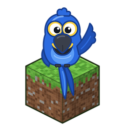
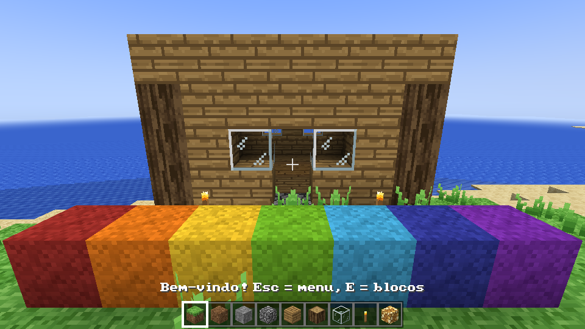

# AraraCraft

<p align="center"></p>

**English** · [Português](README.pt-BR.md)

A block-building sandbox game written in **Rust**, built for speed. It takes the familiar
mine-and-build formula, adds a Terraria-style layer of classes, magic, bosses and coins, and
redoes everything in our own way. Rendering uses **wgpu** on Vulkan (Windows/Linux), Metal (macOS)
or DirectX 12. No Java.



> **Not affiliated with Mojang, Microsoft or Re-Logic.** This is an independent fan project.
> "Minecraft" is a trademark of Mojang Synergies AB / Microsoft and "Terraria" is a trademark of
> Re-Logic; they are mentioned only to describe what inspired the game. The repository contains
> no code, art, sound or music from either game. See [ASSETS-LICENSE.md](ASSETS-LICENSE.md).

## Download

Every push builds the game for Windows, Linux and macOS in GitHub Actions
(**Actions → build → Artifacts**). Tags like `v0.1.0` publish the same files, plus an RPM for
Fedora, as a GitHub Release. Unzip and run `araracraft` (`araracraft.exe` on Windows).
Controls and tips (in Portuguese): [docs/COMO-JOGAR.txt](docs/COMO-JOGAR.txt).

## Build from source

```sh
# Linux needs: libasound2-dev libxkbcommon-dev libudev-dev
cargo run --release -p game
cargo test                       # the world core and the game data are unit tested
```

## What is in it

- Infinite worlds from y -768 up to 255: biomes, caves, ores, structures, the Nether, the End and
  an Underworld at the bottom; distant terrain (LOD) drawn far past the render distance.
- Survival and creative, crafting, smelting, farming, fishing, redstone, enchanting and potions.
- Hundreds of animals, monsters, bosses and townsfolk with procedural animation and 3D skin
  layers; real recorded sounds per creature and per block material.
- Classes in the spirit of Terraria (melee, ranger, mage, summoner, bard, gunner, rogue), a coin
  economy with shops, accessories and buffs, and a progression road with a guide.
- Multiplayer with invite codes and voice chat (group and 3D proximity).
- Mods: the base game is itself a data pack (`packs/vanilla`), plus WebAssembly plugins
  (`plugins-exemplos/`) and WGSL shader packs (`shaderpacks-examples/`).
- Your own music folder, paintings and resource packs (including Minecraft packs you own, loaded
  from your computer only).

## Layout

| Path | What |
|---|---|
| `crates/voxel` | World core with no GPU code: block registry, paletted chunks, world generation, lighting, meshing, physics, saves. |
| `crates/net` | Multiplayer protocol. |
| `crates/game` | The game: window, renderer and shaders, streaming, HUD and menus, mobs, audio. |
| `packs/vanilla` | The base game as a data pack: blocks, items, mobs, recipes, structures, textures (64×64), skins. |
| `assets/` | Music, recorded sounds (with credits) and the app icon. |
| `tools/` | Generators for textures, models, music and sounds. Textures: `python3 tools/tex64/build.py`. |
| `docs/plan` | Design notes: inventory of features, architecture, roadmap, mods, magic/RPG. |

## Performance notes

- Chunks are generated, lit and meshed on all CPU cores; the main thread only uploads results.
- Sections are stored with palettes; faces between solid blocks are never built and vertices are
  packed tightly; sections outside the view are skipped and opaque geometry is drawn front to back.
- `cargo run --release -p voxel --example bench` times generation, lighting and meshing.

## Contributing

See [CONTRIBUTING.md](CONTRIBUTING.md). The short version: only original work or assets with a
compatible licence and credits, never anything from Mojang or Re-Logic, never leaked code.

## Licence

Code: [MIT](LICENSE-MIT) or [Apache 2.0](LICENSE-APACHE), at your option.
Assets: CC BY 4.0 for our own art and music, and the original licences (CC0, CC BY, CC BY-SA)
for the recorded sounds; details in [ASSETS-LICENSE.md](ASSETS-LICENSE.md).
