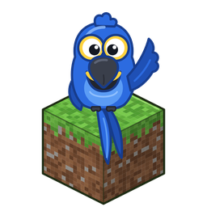
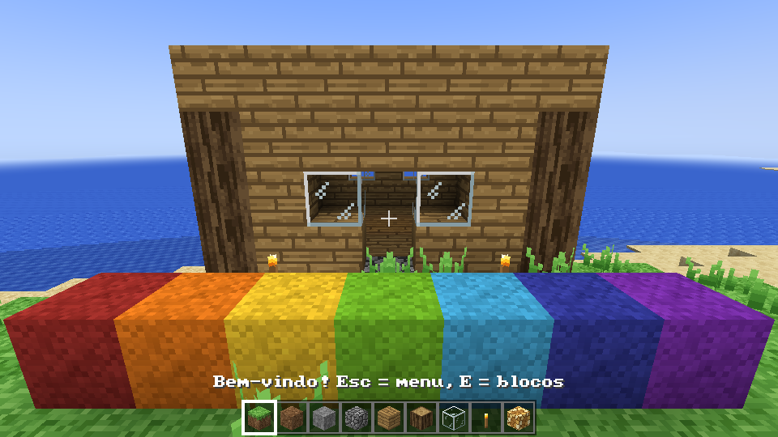

# AraraCraft

<p align="center"></p>

[English](README.md) · **Português**

Um jogo sandbox de construir com blocos, escrito em **Rust** e feito para ser rápido. Ele parte da
fórmula conhecida de minerar e construir, soma uma camada no estilo do Terraria com classes,
magia, chefes e moedas, e refaz tudo do nosso jeito. A renderização usa **wgpu** com Vulkan
(Windows/Linux), Metal (macOS) ou DirectX 12. Nada de Java.



> **Sem vínculo com a Mojang, a Microsoft ou a Re-Logic.** É um projeto independente de fã.
> "Minecraft" é marca da Mojang Synergies AB / Microsoft e "Terraria" é marca da Re-Logic; os
> nomes aparecem só para dizer o que inspirou o jogo. O repositório não tem código, arte, som nem
> música de nenhum dos dois jogos. Veja [ASSETS-LICENSE.md](ASSETS-LICENSE.md).

## Baixar

Cada push gera o jogo para Windows, Linux e macOS no GitHub Actions
(**Actions → build → Artifacts**). Tags como `v0.1.0` publicam os mesmos arquivos, mais um RPM
para Fedora, como uma Release no GitHub. Descompacte e abra `araracraft` (`araracraft.exe` no
Windows). Controles e dicas: [docs/COMO-JOGAR.txt](docs/COMO-JOGAR.txt).

## Compilar

```sh
# No Linux instale: libasound2-dev libxkbcommon-dev libudev-dev
cargo run --release -p game
cargo test                       # o núcleo do mundo e os dados do jogo têm testes
```

## O que tem

- Mundos infinitos de y -768 até 255: biomas, cavernas, minérios, estruturas, Nether, End e um
  Submundo no fundo; terreno distante (LOD) desenhado bem além da distância de renderização.
- Sobrevivência e criativo, artesanato, fornalhas, plantações, pesca, redstone, encantamentos e
  poções.
- Centenas de animais, monstros, chefes e moradores com animação procedural e camadas 3D na
  pele; sons gravados de verdade para cada criatura e cada material de bloco.
- Classes no espírito do Terraria (guerreiro, arqueiro, mago, invocador, bardo, atirador,
  assassino), economia de moedas com lojas, acessórios e efeitos, e um caminho de progressão com
  um guia.
- Multijogador com código de convite e chat de voz (em grupo e por proximidade 3D).
- Mods: o próprio jogo base é um pacote de dados (`packs/vanilla`), mais plugins WebAssembly
  (`plugins-exemplos/`) e pacotes de shader WGSL (`shaderpacks-examples/`).
- Sua própria pasta de músicas, pinturas e pacotes de textura (inclusive pacotes do Minecraft que
  você tenha, lidos só do seu computador).

## Organização

| Pasta | O que é |
|---|---|
| `crates/voxel` | Núcleo do mundo sem GPU: registro de blocos, chunks com paleta, geração, luz, malhas, física, saves. |
| `crates/net` | Protocolo do multijogador. |
| `crates/game` | O jogo: janela, renderizador e shaders, streaming, HUD e menus, mobs, áudio. |
| `packs/vanilla` | O jogo base como pacote de dados: blocos, itens, mobs, receitas, estruturas, texturas 64×64, peles. |
| `assets/` | Músicas, sons gravados (com créditos) e o ícone. |
| `tools/` | Geradores de texturas, modelos, música e sons. Texturas: `python3 tools/tex64/build.py`. |
| `docs/plan` | Notas de design: inventário, arquitetura, roteiro, mods, magia/RPG. O resumo em português é [docs/plan/RESUMO.md](docs/plan/RESUMO.md). |

## Contribuir

Veja [CONTRIBUTING.md](CONTRIBUTING.md). Resumindo: só trabalho original ou material com licença
compatível e créditos, nunca nada da Mojang ou da Re-Logic, nunca código vazado.

## Licença

Código: [MIT](LICENSE-MIT) ou [Apache 2.0](LICENSE-APACHE), à sua escolha.
Arte e música próprias: CC BY 4.0. Sons gravados: as licenças originais (CC0, CC BY, CC BY-SA);
detalhes em [ASSETS-LICENSE.md](ASSETS-LICENSE.md).
